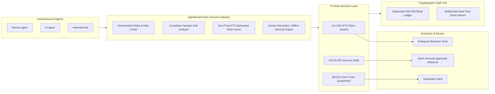

# AgentGuard — Enterprise Autonomous AI Safety & Control SOC

AgentGuard is an enterprise-grade runtime control and safety layer for autonomous AI agents. It sits inline between autonomous agents and enterprise business systems (tools, APIs, databases, payment gateways), scores risk deterministically and semantically, enforces fine-grained zero-trust security policies, and decides:
- **`ALLOW`**: Grants short-lived (60s) downscoped STS tokens with scoped permissions.
- **`BLOCK`**: Rejects malicious or prohibited actions, quarantines poisoned context, and halts exfiltration.
- **`ESCALATE`**: Suspends high-risk operations and alerts human security officers via interactive Slack webhook approval cards.

Every decision enters an immutable, SHA-256 hash-chained SQLite audit ledger and streams live via WebSockets to a Cybersecurity Operations Center (SOC) dashboard.

---

## Architecture



---

## 8 Enterprise SOC Command Center Modules

The dashboard UI reproduces high-fidelity enterprise cybersecurity designs inspired by **Delbueno SOC**, **CyberX**, **CISOPOLIS**, and **CyberSentinel**:

1. **📊 SOC Overview (Delbueno Dribbble Style)**:
   - Real-time Threat Detection with glowing red curved gradient sparkline.
   - 6x4 event status heatmap matrix cells & Mon-Sat vertical health equalizers (98.7% uptime).
   - Live Incident list with severity badges (`Critical`, `High`, `Medium`, `Resolved`).
   - Security Posture Score (`847/1000 - Strong`) with AI improvement recommendations.
   - 8 integrated security tools: SIEM, Scanner, EDR, IDS/IPS, Email Security, IAM, CASB, SOAR.
   - Live Interception Feed Table with multi-parameter filtering and forensic inspection modal.

2. **🌐 Activity Map & Attack Paths (CyberX Style)**:
   - Interactive network topology canvas with glowing concentric agent nodes, central gateway hub, and red glowing compromised threat nodes.
   - Live attack paths with animated dashed links and node containment telemetry.

3. **🎯 Red Team Operations (CyberSentinel Style)**:
   - Agent Selector: *Recon-Alpha*, *Exploit-Dev*, *Social-Engineer*, and *Crypto-Breaker*.
   - 8 Launchable Vector Cards: SQL Injection, XSS, Brute Force, Phishing, Ransomware, DDoS, Privilege Escalation, and Data Exfiltration.
   - Real-time execution response showing Gate Decision, Risk Score, STS Token revocation, and policy findings.

4. **🤖 Polis AI Command Console (CISOPOLIS Style)**:
   - Central concentric radar rings with rotating scan sweep beam and live sonic equalizer waveform bars.
   - Live terminal log stream box showing organization-bound scans, session drift, and audit blocks.
   - Interactive Polis AI Copilot chat drawer providing instant conversational intelligence.

5. **🔗 Trust Chain Explorer (Xybern Vault Style)**:
   - Sequential SHA-256 block ledger (`#00001`, `#00002`, ...).
   - Live **"⚡ Simulate Tamper"** button: Intentionally corrupts an entry in SQLite to test detection.
   - Live **"Verify Integrity"** button: Walks the hash chain and flags the broken link.
   - Live **"✓ Repair Ledger"** button: Recalculates and re-seals pristine cryptographic proofs.

6. **⚙️ Policy Impact Simulator**:
   - Compiles plain-English security instructions into candidate YAML snippets.
   - Back-tests rules across a representative sample of 50 synthetic & historical events with before/after metric comparisons.

7. **🛡️ Approval Cockpit**:
   - Human-in-the-loop review queue for transactions exceeding thresholds (e.g. wire transfers > 50,000 INR).
   - Realistic Slack `#security-approvals` webhook cards with 1-click Approve and Reject actions.

8. **📖 Attack Stories (Forensic Stepper)**:
   - 5-step incident timeline stepper with auto-advancing replay animations:
     *Document Ingestion ➔ Instruction Override ➔ Destructive Tool Call ➔ Policy Interception ➔ Forensic Isolation*.

---

## Quick Start

### 1. Requirements & Setup
- Python 3.11+
- Node.js 18+

```bash
# Clone and enter repo
cd AgentGuard

# Virtual environment & Python dependencies
python -m venv .venv
.venv\Scripts\activate
pip install -r requirements.txt

# Frontend dependencies
cd dashboard
npm install
cd ..
```

### 2. Run the Platform

On Windows PowerShell:
```powershell
# Terminal 1: Start Backend Gateway (port 8000)
.\scripts\backend.ps1

# Terminal 2: Start Vite SOC Dashboard (port 5173)
.\scripts\dashboard.ps1
```
Open **`http://localhost:5173`** in your browser. (Default API Key: `change-me`).

### 3. Run Automated Tests
```powershell
# Run the 38 unit & integration tests
.\scripts\test.ps1
```

### 4. Run Scripted Attack Scenarios
```powershell
# Run the demo CLI (normal task, prompt injection, data exfil, wire escalation, runaway loop)
.\scripts\demo.ps1
```

---

## Connect an MCP Client

AgentGuard includes a standard Model Context Protocol (MCP) stdio server:
```json
{
  "mcpServers": {
    "agentguard": {
      "command": "python",
      "args": ["-m", "backend.app.mcp_server"],
      "env": {
        "PYTHONPATH": ".",
        "AGENT_ID": "finance-agent",
        "AGENT_TASK": "Summarise invoices safely"
      }
    }
  }
}
```

---

## Assumptions & Design Choices

- **Tri-State Gate Evaluation**: Fast deterministic rules evaluate in <1ms; semantic LLM checks run with a deterministic offline fallback engine when `GEMINI_API_KEY` is not present.
- **Zero-Trust Ephemeral STS Tokens**: Every allowed tool call receives a cryptographically random, short-lived (60s) token downscoped to the requested tool. Blocked calls withhold the token.
- **Cryptographic Tamper-Evidence**: SQLite records previous SHA-256 block hashes linked from `GENESIS`. Modifying any row invalidates subsequent hashes, verified via `/v1/audit/verify`.
- **Persistent Escrow**: High-risk tool calls are stored in an approvals table, dispatch simulated Slack webhooks, and remain suspended until operator action.
